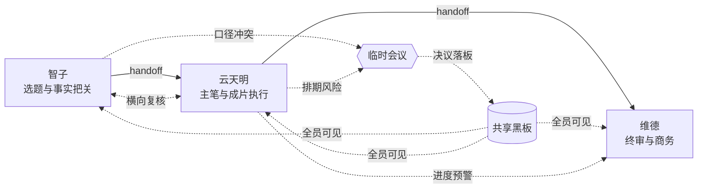

# 三体 AI 内容工作室 · Grok Bot

> 一支**默认 3 人**的 AI 小队，跑在一条**会交接、会横向追问、会临时开会**的生产线上。
> Grok 当大脑，GitHub 当办公室，所有说过的话都能逐条回放。

```
trio（默认）  智子 → 云天明 → 维德                       把关 / 执行 / 拍板
duo           云天明 → 维德                             一人做 / 一人管
full          智子 → 罗辑 → 云天明 → 章北海 → 程心 → 庄颜 → 维德
```

一次默认三人运行产生 **35 条内部消息、3 份交付物、2 次临时会议、2 份落板决议**，
可直接打开 [`examples/demo-trio/dashboard.html`](examples/demo-trio/dashboard.html) 看全程。
`--team duo` 是 26 条消息 / 2 份交付物；
`--team full` 切回七人完整版则是 69 条消息 / 7 份交付物（样例见 [`examples/demo-run/dashboard.html`](examples/demo-run/dashboard.html)）。

人数是配置项，不是架构限制：消息收发方、会议参与人、决议责任人、交付物下一棒全部按在编名单动态生成，精简后不会出现「给不存在的同事派活」。

---

## 一、为什么不是「一个 AI 套几个提示词」

| | 普通多提示词流水线 | 本仓库 |
| --- | --- | --- |
| 传递方式 | 函数 A 的返回值塞给函数 B | **消息总线 handoff**，带收件人、附件、回执、回复链 |
| 共享状态 | 各自只看自己的上下文 | **共享黑板**，在编成员读写同一张任务板（状态机 + 产物登记） |
| 意见不合 | 无人处理，硬往下传 | 可**跨岗位质疑**、可越级汇报、可把活儿退回上游 |
| 临时协作 | 没有 | 任一员工可**拉会**：多轮发言 → 表态 → 主持人收敛决议 → 行动项自动落板 |
| 可追溯 | 只有最终输出 | `messages.jsonl` / `board.json` / 会议纪要 / HTML 看板全量留痕 |
| 岗位定义 | 散落在代码里 | 外置 `team-*.json`，改人设、人数、上下游、产线都不用改代码 |

### 四个核心机制

1. **消息总线 `bus.py`** — `assign / handoff / report / chat / meeting_invite / vote / decision / system` 八种消息，支持定向、`@all` 广播、`in_reply_to` 回复链、未读收件箱。
2. **共享黑板 `board.py`** — 任务状态机 `backlog → in_progress → review → done`（可 `blocked`），交付物挂卡，会议决议落成带责任人和截止时间的任务卡。
3. **横向沟通 `workflow.py`** — 产线是线性的，沟通是网状的：下游向上游复核口径、执行岗向统筹预警节点风险；七人完整版还保留罗辑驳回智子、云天明提前找程心、章北海向庄颜报账这些定点互动。
4. **临时会议 `meeting.py`** — 不是装饰：由**真实触发条件**拉起（事实越界 / 排期挤压终审），开完把决议写进下游的上下文，下游必须遵守。



上图是默认三人编制；`--team full` 时产线和触发点会自动换成七人版本。

---

## 二、花名册与三种编制

| 编制 | 命令 | 人数 | 适用 |
| --- | --- | --- | --- |
| **trio**（默认） | `--team trio` | 3 | 日常使用，岗位合并但机制完整，看板最清爽 |
| **duo** | `--team duo` | 2 | 只想看「一个做、一个管」的最小协作，会议为对谈 + 决议 |
| **full** | `--team full` | 7 | 演示完整分工、多人表决与网状沟通 |

默认三人编制的岗位由七人版合并而来：

| 角色 | 岗位 | 兼了原来的 | 上游 → 下游 |
| --- | --- | --- | --- |
| **智子** SOPHON | 选题与事实把关 | 智子 + 罗辑 | — → 云天明 |
| **云天明** YUNTIANMING | 主笔与成片执行 | 云天明 + 章北海 + 程心 | 智子 → 维德 |
| **维德** WADE | 总负责人 / 终审与商务 | 维德 + 庄颜 | 云天明 → — |

七人完整版的七份岗位说明书见 [`team.json`](team.json)，字段含义与三人版一致。
`python3 -m sanbot roster --team full` 可直接打印完整花名册。

---

## 三、30 秒跑起来（不用装任何依赖）

```bash
git clone <你的仓库地址>
cd three-body-ai-team
bash scripts/demo.sh                  # 默认三人编制，跑完自动打开看板
# bash scripts/demo.sh full          # 想看七人完整版
```

纯 Python 标准库，Python 3.10+，无 `pip install`。`--mock` 是离线演示大脑：
**不联网、不花钱，但整条协作链、交接、开会、看板都是真的**，先验收再配密钥。

```bash
python3 -m sanbot run --mock --meetings 2                 # 三人
python3 -m sanbot run --mock --team duo --meetings 1      # 两人
python3 -m sanbot run --mock --team full --meetings 2     # 七人
python3 -m sanbot run --mock --team ./my-team.json        # 自定义编制
```

### 接上 Grok（真正的大脑）

```bash
cp .env.example .env
# 编辑 .env 填 XAI_API_KEY
python3 -m sanbot run --grok --brief "做一期 60 秒短视频：AI 智能体怎么开会" --meetings 2
```

走 xAI 的 OpenAI 兼容接口 `https://api.x.ai/v1/chat/completions`。
因为协议兼容，把 `XAI_BASE_URL` + `GROK_MODEL` 换成任意兼容端点也能直接跑。
系统提示里会带上「在编名单 / 主持人 / 我的下一棒」，模型不会向名单外的人派活。

| 环境变量 | 默认值 | 说明 |
| --- | --- | --- |
| `XAI_API_KEY` | — | xAI API Key；没填就自动降级 mock |
| `GROK_MODEL` | `grok-4-fast` | 模型名，可换成你账号可用的版本 |
| `XAI_BASE_URL` | `https://api.x.ai/v1/chat/completions` | OpenAI 兼容端点 |
| `SANBOT_LLM` | `auto` | `auto` / `grok` / `mock` |
| `GITHUB_TOKEN` / `GITHUB_REPOSITORY` | — | Issue bot 与 Actions 用 |
| `TEAM_PRESET` | `trio` | Actions 里指定默认编制 |

### 命令表

| 命令 | 作用 |
| --- | --- |
| `python3 -m sanbot run --mock --meetings 2` | 跑完整产线，自动触发 0/1/2 次临时会议 |
| `python3 -m sanbot run --team duo --mock` | 用指定编制跑（所有命令都支持 `--team`） |
| `python3 -m sanbot meeting --topic "备用金要不要动" --team duo` | 手动拉一次临时会 |
| `python3 -m sanbot intel --grok` | 抓 arXiv cs.AI / Hacker News 出简报 |
| `python3 -m sanbot roster --team full` | 花名册 |
| `python3 -m sanbot status` | 最近一次共享黑板状态 |
| `python3 -m sanbot dashboard --run-dir runs/demo` | 重新生成 HTML 协作看板（自动读取编制快照） |
| `python3 -m sanbot issue --repo owner/repo --number 12` | 处理 GitHub Issue 里的 `/team` 命令 |

> 给 `--meeting --initiator` 传了不在编的角色时会安静地回落到主持人，不会报错，也不会出现幽灵发言人。

---

## 四、放到 GitHub 上跑

### 1. 推仓库（不用敲命令，也不用粘贴 Token）

**最省事：在 Finder 里双击项目根目录的 `一键推送.command`**。
它会自动读剪贴板里的 Token；如果还没有，就自动打开生成页并告诉你下一步，
全程不用打开终端、不用敲命令。首次双击若被系统拦，右键 → 「打开」即可。

习惯用终端的话，等价的两条命令是：

```bash
bash scripts/finish_push.sh --open    # ① 打开 Token 生成页（repo + workflow 权限已预填）
# 网页上：登录 → 拉到底点 Generate token → 点「复制」
bash scripts/finish_push.sh           # ② 自动从剪贴板读取并推送
```

第 ② 步会按顺序找 Token：**环境变量 → 项目 `.env` → 系统剪贴板 → 手动粘贴（不回显）**。
识别到剪贴板里的 `ghp_...` 就直接用，**内容不会显示在终端、不会写进任何文件、不会进 git**。
其余全自动：校验身份 → 建仓 → 上传全部文件 → 生成一次提交 → 验证。

底层走 `scripts/push_via_api.py`，**只访问 `api.github.com`，不依赖 `gh`、不走 `git push`**，
因此本机网络策略拦截 `github.com` 时也能推。

> 如果这台机器连 `github.com` 网页也打不开，用**手机浏览器**打开同一个链接：
> `https://github.com/settings/tokens/new?description=three-body-ai-team&scopes=repo,workflow`
> 生成后点复制，Apple 通用剪贴板会同步到 Mac，第 ② 步照样能读到。
> 不想用剪贴板，把 Token 贴给 AI 代跑也可以；用完记得在 `https://github.com/settings/tokens` 撤销。

其他用法：

```bash
bash scripts/finish_push.sh --clipboard   # 强制只读剪贴板（非交互场景）
bash scripts/finish_push.sh --manual      # 忽略剪贴板，手动粘贴
bash scripts/finish_push.sh --dry-run     # 只预览将上传的文件，不需 Token、不联网
bash scripts/finish_push.sh --private     # 建私有仓库
```

也可以把 Token 写进项目根目录的 `.env`（已被 `.gitignore` 忽略，不会上传）：

```dotenv
GITHUB_TOKEN=ghp_你的Token
GITHUB_OWNER=Fuxizengxiao520
GITHUB_REPO=three-body-ai-team
```

> Token 要填 **Personal Access Token**（`ghp_...` 或 `github_pat_...` 开头），
> 不是邮箱、账号名或登录密码——GitHub 自 2021 年起已禁用密码推送。粘错时脚本会直接提示。

> 备选：网络允许 `git push` 时可用 `bash scripts/push_to_github.sh <用户名> <仓库名> public`，
> 它优先用 `gh`，否则用一次性凭据 URL 推送（会保留本地 git 历史）。

### 2. 在 Issue 里给团队派活

新建 Issue，正文写一行命令即可，Actions 会自动跑并把结果回帖到该 Issue：

```
/team run 做一期 90 秒短视频：AI 智能体怎么像同事一样交接
```

| Issue 命令 | 效果 |
| --- | --- |
| `/team run <任务>` | 按当前编制全跑，回帖交付摘要 |
| `/team meeting <议题>` | 临时开会，回帖决议与行动项 |
| `/team intel` | 出情报简报，另开一份 Issue |
| `/team status` | 回帖看板状态 |
| `/team roster` | 回帖花名册（含编制信息） |

命令也可以写在**评论**里；评论优先于 Issue 正文。默认编制由仓库变量 `TEAM_PRESET` 控制（未设置时为 `trio`）。

### 3. 两个 Actions

| Workflow | 触发 | 干什么 |
| --- | --- | --- |
| `team-command.yml` | Issue 新建 / 评论含 `/team ` | 执行团队命令、回帖、上传运行产物为 artifact |
| `daily-intel.yml` | 每天 UTC 01:00（北京 09:00） | 抓前沿资讯并开一份简报 Issue |

**要配的 Secret**：`XAI_API_KEY`（Settings → Secrets → Actions）。
`GITHUB_TOKEN` 由 Actions 自动注入，需要 `issues: write` 权限（workflow 里已声明）。
未配 `XAI_API_KEY` 时每日资讯任务会明确跳过，不生成空简报。

---

## 五、目录结构

```
three-body-ai-team/
├── team-trio.json               # 默认：三人编制
├── team-duo.json                # 两人极简编制
├── team.json                    # 七人完整编制
├── sanbot/
│   ├── models.py                # 消息 / 任务 / 产物 / 决议 数据模型
│   ├── bus.py                   # 内部消息总线（JSONL 全量留痕）
│   ├── board.py                 # 共享黑板 + 任务状态机
│   ├── llm.py                   # GrokClient + MockLLM + 自动降级
│   ├── skills.py                # 岗位交付物规格 + 离线样例（按在编名单适配）
│   ├── agents.py                # 员工：读收件箱、回执、干活、交接、汇报；编制解析
│   ├── meeting.py               # 临时会议：多轮 / 表决 / 决议 / 落板
│   ├── workflow.py              # 制片厂：产线编排 + 横向沟通 + 会议触发
│   ├── intel.py                 # 公开源资讯雷达
│   ├── render.py                # 沟通时间线 → 离线 HTML 看板
│   ├── github_bot.py            # GitHub Issue 命令解析与回帖
│   └── __main__.py              # CLI
├── .github/workflows/           # 两个自动化
├── scripts/                     # 推送 / 演示脚本
├── examples/demo-run/           # 七人完整版一次运行的真实产物
└── runs/                        # 本地运行目录（已 gitignore）
```

### 运行产物（每次运行一个目录）

| 文件 | 内容 |
| --- | --- |
| `messages.jsonl` | **全员沟通逐条记录**，含交接、追问、表决、决议 |
| `board.json` | 共享黑板快照：任务状态、产物、决议 |
| `team.json` | **本次编制快照**，之后重生成看板时用它还原人名与岗位 |
| `artifacts/*.md` | 每位在编员工的交付物 |
| `meetings/*.md` | 临时会议纪要：逐字记录 + 表决 + 决议 + 行动项 |
| `run_summary.md` | 本次交付链小结（含编制与人数） |
| `dashboard.html` | **协作看板**（离线可开，看全员时间线） |

---

## 六、改造成你自己的团队

- **换人数** → `--team trio / duo / full`，或直接传自定义 json 路径；默认由 `agents.py` 的 `DEFAULT_TEAM` 决定。
- **加人 / 换人 / 调顺序** → 编辑任一 `team-*.json` 的 `members` 与 `pipeline`，`meeting_moderator` 可换主持人；pipeline 里出现未定义角色会在启动时明确报错。
- **改每个人交付什么** → `skills.py` 的 `SKILLS[角色id]["spec"]`，这是给 Grok 的输出要求；新角色自动走通用兜底规格。
- **改什么时候自动开会** → `workflow.py` 的 `run()`：完整编制按岗位触发，精简编制按产线位置触发。
- **接真实数据源** → `intel.py` 换源；账单/排期接你的财务系统可替换对应技能包。
- **接 X / 企业微信 / 飞书** → 照 `github_bot.py` 的 `handle_*` 模式加一个入口，`Studio` 不用改。

---

## 七、几句老实话（能力边界）

- 这里的 **Grok 是大脑**（xAI 大模型 API），不是 X 平台上的 `@grok` 账号机器人，也不会自动发推。要接 X，需要另配 X API 与 webhook，扩展点在 `github_bot.py`。
- 「像真实员工」指的是**有岗位、有交接、有共享状态、有会议决议**，不是 AI 自发产生意识或真的主动上班。会议由代码按真实触发条件编排多轮发言，发言内容由模型生成。
- **无 Key 时是本地 mock**：交付物是结构化样例，用来验收协作流程，不是 Grok 生成的内容；看板会明确标注 `Mock (离线演示)`。样例文案以七人编制为底稿，运行时会按在编名单自动改写人名、人数和下一棒。
- 两人编制下会议只有一名参会人 + 主持人，仍有多轮发言、表决与决议，但**没有多人意见交锋**——想看分歧收敛请用 `trio` 或 `full`。
- 资讯雷达抓公开 RSS / API，网络不可达会**明确降级、不编造条目**；离线模式只做关键词粗筛并标注「未经语义核验」。
- 演示里的账单、报价、排期是样例数据，接真实业务请替换数据源后再用于决策。

---

MIT License · 角色名与《三体》相关设定归原作者所有，本项目仅作个人致敬与技术演示。
